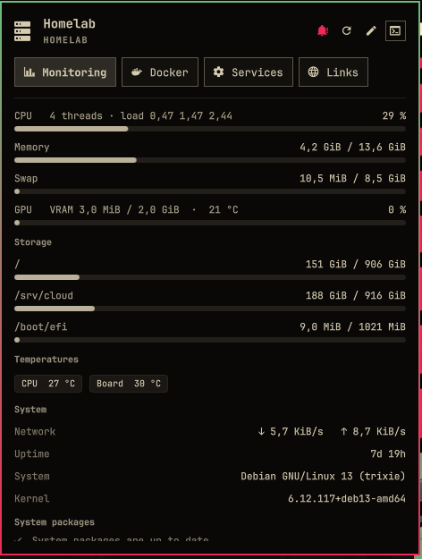

# Homelab pour Omarchy

[English](README.md) · **Français**

<p align="center"></p>

Un widget de barre pour le shell d'[Omarchy](https://omarchy.org) qui surveille
vos serveurs homelab en SSH : rien à installer sur le serveur.

- **Monitoring** : CPU, mémoire, swap, GPU (NVIDIA / AMD), chaque disque monté,
  capteurs de température, débit réseau, uptime, OS et noyau. Une section
  n'apparaît que si le matériel est présent.
- **Proxmox VE** : sur un hôte Proxmox, un onglet Proxmox apparaît avec
  chaque nœud, VM et conteneur LXC du cluster (état, CPU, mémoire, uptime,
  tags), recherche et filtres, démarrage, extinction et redémarrage (second
  clic pour confirmer), la console noVNC ou xterm.js dans le navigateur,
  l'occupation des stockages et les tâches en échec des dernières 24 h. Les
  alertes couvrent une VM ou un conteneur arrêté tout seul, un nœud hors
  ligne, un stockage qui se remplit et une sauvegarde en échec. Les mises à
  jour utilisent `apt full-upgrade`, comme Proxmox l'exige.
- **Docker** : chaque conteneur avec son état, son CPU et sa mémoire ;
  démarrer, arrêter, redémarrer, suivre les logs dans un terminal, et mettre à
  jour (pull de l'image, puis recréation du conteneur via son projet Compose si
  l'image a changé ; double clic pour confirmer). Recherche par nom ou image,
  tri par nom, date de création, CPU ou mémoire (croissant ou décroissant),
  filtre tous, actifs, arrêtés ou avec mise à jour disponible. Se rabat sur `sudo docker` sans mot de passe
  ou sur `podman`.
- **Services** : choisissez un service dans la liste déroulante pour le
  consulter et le piloter :
  - **Home Assistant** : nombre d'entités, entités indisponibles, allumer ou
    éteindre lumières, interrupteurs et ventilateurs, lancer scènes et scripts.
  - **Jellyfin** : taille de la bibliothèque, qui regarde quoi (progression et
    transcodage), tâches en cours, scan de la bibliothèque.
  - **Prowlarr** : alertes de santé, état des indexeurs, test de tous les
    indexeurs, recherche sur tous les indexeurs et envoi d'un résultat au
    client de téléchargement.
  - **Navidrome** : nombre de titres et état du scan, lecture en cours, albums
    récemment ajoutés, scan de la bibliothèque.
- **Alertes et notifications** : une surveillance en arrière-plan contrôle
  chaque hôte même panel fermé, et envoie une notification de bureau par
  nouveau problème : hôte injoignable (et de retour), conteneur arrêté, qui
  redémarre en boucle ou en mauvaise santé, disque, mémoire ou température
  au-delà du seuil, service qui ne répond plus, erreurs de santé Prowlarr et
  indexeurs en échec, redémarrage requis. L'icône de la barre affiche le
  nombre d'alertes actives ; la cloche du panel (ou `a`) ouvre le centre
  d'alertes. Un clic sur une notification ouvre le panel.
- **Paquets système** (onglet Monitoring) : mises à jour en attente avec
  version actuelle et nouvelle, correctifs de sécurité en tête, âge des
  listes, opération sur les paquets en cours, et redémarrage requis (fichier
  témoin, `needs-restarting`, ou noyau installé plus récent que celui en
  cours). « Vérifier » rafraîchit les listes sans root quand le gestionnaire
  le permet, sans interroger les registres d'images : quelques secondes
  suffisent. « Mettre à jour » ouvre un terminal qui lance la mise à jour de
  la distribution avec sudo (ou doas), puis Flatpak et Snap, quel que soit le
  shell de connexion ; le widget revérifie une fois terminé.

  | Gestionnaire | Distributions | Listes rafraîchies sans root |
  | --- | --- | --- |
  | apt | Debian, Ubuntu, Mint, Raspberry Pi OS… | oui, cache privé compressé dans `~/.cache/omarchy-homelab` (~85 Mo) |
  | dnf / yum | Fedora, RHEL, Rocky, Alma, CentOS | oui, cache de métadonnées utilisateur |
  | pacman | Arch, Manjaro, EndeavourOS | oui avec `checkupdates` (pacman-contrib), sinon listes système |
  | zypper | openSUSE, SLES | non, métadonnées système (sécurité comptée via les patches) |
  | apk | Alpine | oui, `--no-cache` |
  | xbps | Void | oui, synchronisation en mémoire |
  | Flatpak, Snap | toutes, en plus | oui |
- **Vérification des mises à jour** : toutes les quelques heures (et à la
  demande), le digest de chaque image est comparé à son registre sans
  téléchargement, les paquets système en attente sont comptés (apt, pacman,
  dnf), et les services sont interrogés directement (entités `update` de Home
  Assistant, Jellyfin, Prowlarr). Mettez à jour une image ou toutes depuis le
  centre d'alertes, ou ouvrez un terminal qui lance la mise à jour système.
- **Liens** : raccourcis par hôte (Homepage, Portainer, Jellyfin…).
- **Bouton SSH** : ouvre `ssh <hôte>` dans votre terminal par défaut.
- Plusieurs hôtes, sélectionnables depuis le panel.
- Interface en anglais et en français.

## Prérequis

Sur la machine Omarchy (tout est fourni avec Omarchy) : `ssh`, `curl`, `jq`,
`notify-send`, `xdg-open`, `xdg-terminal-exec`, `md5sum`.

Sur chaque hôte du homelab : un serveur SSH avec connexion par clé, un `sh`
POSIX et les coreutils habituels. En option, selon les fonctions :

- Onglet Docker et mises à jour d'images : `docker` accessible à
  l'utilisateur SSH (groupe docker, `sudo docker` sans mot de passe, ou
  `podman`), `docker compose` et `docker buildx` (fournis avec Docker Engine).
- Métriques GPU : `nvidia-smi` (NVIDIA) ou le pilote amdgpu.
- Mises à jour des paquets : apt, dnf, yum, pacman (`pacman-contrib` pour
  `checkupdates`), zypper, apk ou xbps ; Flatpak et Snap sont aussi pris en
  compte.
- Services : Jellyfin, Home Assistant, Prowlarr ou Navidrome avec une clé
  API, un jeton ou un compte.

Rien n'est installé sur les hôtes. Le plugin n'y écrit que
`~/.cache/omarchy-homelab/` (cache des listes apt, script de mise à jour).

## Installation

```bash
omarchy plugin add https://github.com/dadoux01/omarchy-homelab --enable
```

Le widget est ajouté à droite de la barre. Cliquez dessus, puis sur le
crayon, pour créer votre fichier d'hôtes.

## Désinstallation

```bash
omarchy plugin remove dadoux01.homelab
```

Cela supprime le plugin et son entrée dans la barre. Vos fichiers sont
conservés ; supprimez-les si vous n'en voulez plus :

```bash
rm -f ~/.config/omarchy/homelab.json ~/.config/omarchy/homelab-secrets.json
rm -rf ~/.local/state/omarchy-homelab
ssh <hôte> rm -rf .cache/omarchy-homelab   # sur chaque hôte du homelab
```

## Configuration

Cliquez sur le crayon dans le panel (ou appuyez sur `e`) pour créer et ouvrir
`~/.config/omarchy/homelab.json` :

```json
{
  "hosts": [
    {
      "name": "Homelab",
      "ssh": "user@192.168.1.10",
      "port": 22,
      "links": [
        { "name": "Homepage", "url": "http://192.168.1.10:3000" }
      ]
    }
  ]
}
```

### Services

Les services sont détectés à partir des conteneurs Docker de l'hôte (nom de
l'image), et leur URL à partir du port publié ; Home Assistant en réseau
`host` utilise le port 8123. Vous pouvez les surcharger ou les ajouter par
hôte :

```json
"address": "192.168.1.10",
"services": {
  "homeassistant": { "url": "http://192.168.1.10:8123", "entities": ["light.salon", "scene.film"] },
  "jellyfin": { "url": "https://jellyfin.exemple.lan", "insecure": true },
  "prowlarr": false
}
```

`address` remplace l'hôte SSH dans les URL détectées. `insecure` accepte un
certificat auto-signé. `false` masque un service.

Les identifiants se saisissent dans le panel (bouton clé) et sont stockés dans
`~/.config/omarchy/homelab-secrets.json`, en mode 600, jamais dans
`homelab.json`. La clé de Prowlarr peut être lue via SSH dans son `config.xml`
en un clic. Les appels API passent par `curl`, avec le secret transmis par un
pipe et non sur la ligne de commande.

`ssh` accepte `user@hôte`, un hôte seul, ou un alias de `~/.ssh/config`.
L'authentification doit fonctionner sans invite (clé SSH, agent), car le panel
lance ssh avec `BatchMode=yes`. Le bouton SSH interactif n'a pas cette
contrainte.

### Proxmox VE

L'onglet Proxmox apparaît tout seul quand l'hôte tourne sous Proxmox VE. Il
lit le cluster de l'une de ces deux façons :

- **Jeton API (recommandé)** : dans Proxmox, Datacenter › Permissions ›
  API Tokens, créez un jeton, puis collez son ID (`user@realm!nom`) et son
  secret dans l'onglet Proxmox (bouton clé). En lecture seule, donnez-lui le
  rôle `PVEAuditor` sur `/` ; ajoutez `VM.PowerMgmt` pour démarrer et arrêter
  les machines. Le jeton est stocké comme les autres secrets.
- **SSH** : `pvesh` demande root, donc cela fonctionne si vous vous connectez
  en root ou si l'utilisateur SSH a sudo sans mot de passe.

L'API est jointe sur `https://<hôte>:8006`, avec le certificat auto-signé de
Proxmox accepté. Vous pouvez la changer par hôte, ou désactiver l'onglet :

```json
"proxmox": { "url": "https://pve.exemple.lan:8006", "insecure": false }
"proxmox": false
```

### Réglages du widget

| Réglage | Défaut | |
| --- | --- | --- |
| Langue | `English` | `English` ou `Français` |
| Fichier des hôtes | `~/.config/omarchy/homelab.json` | |
| Fichier des secrets | `~/.config/omarchy/homelab-secrets.json` | |
| Intervalle de rafraîchissement | `10` s | uniquement quand le panel est ouvert |
| Notifications de bureau | activées | |
| Notifier les mises à jour | activé | |
| Intervalle de surveillance | `120` s | quand le panel est fermé |
| Intervalle de vérification des mises à jour | `6` h | `0` désactive la vérification automatique |
| Seuils disque / mémoire / température | `90` % / `95` % / `85` °C | |

Ils sont stockés sur l'entrée du widget dans `~/.config/omarchy/shell.json`,
qui se recharge à l'enregistrement :

```json
{ "id": "dadoux01.homelab", "language": "Français" }
```

### État des alertes et mises à jour

Les événements déjà notifiés et la dernière vérification sont conservés dans
`~/.local/state/omarchy-homelab/state.json`, pour qu'un redémarrage du shell
n'annonce pas deux fois la même chose. Une alerte résolue est de nouveau
annoncée si elle revient.

La vérification des images nécessite `docker buildx` sur l'hôte (fourni avec
Docker Engine). La recréation d'un conteneur lance `docker compose up -d --no-deps <service>`
avec le projet, les fichiers et le dossier lus dans les labels Compose du
conteneur. Les gestionnaires de stacks comme Dockge créent des fichiers
`.env` appartenant à root et illisibles pour un utilisateur du groupe docker :
la mise à jour passe alors par `sudo` sans mot de passe, puis par compose
lancé dans un conteneur qui monte le socket Docker et le dossier de la stack
au même chemin (c'est le cas de Dockge). Un pull en échec (limite, hors
ligne) recrée quand même le conteneur si une image plus récente a déjà été
téléchargée. En cas d'échec, l'erreur de compose s'affiche sous le conteneur.

Docker Hub limite les requêtes anonymes par IP ; quand la limite est
atteinte, le centre d'alertes l'indique et les images concernées sont
vérifiées au contrôle suivant. Un `docker login` sur l'hôte relève cette
limite. Un conteneur dont le tag pointe déjà vers une image plus récente
téléchargée est signalé « téléchargée, recréation nécessaire ».
Un tag figé sur une version (`app:1.2.3`) n'est signalé que si
le registre republie ce tag ; passer à une version plus récente demande de
modifier le fichier compose.

## Raccourcis (panel ouvert)

| Touche | Action |
| --- | --- |
| `h` / `l`, `←` / `→`, `1` – `5` | changer d'onglet (5 avec l'onglet Proxmox) |
| `[` / `]` | hôte précédent / suivant |
| `s` ou `Entrée` | terminal SSH |
| `r` | actualiser |
| `e` | modifier le fichier des hôtes |
| `a` | alertes et mises à jour |

Dans la barre : clic gauche pour ouvrir le panel, clic du milieu pour le SSH,
clic droit pour actualiser.

## Fonctionnement

Les métriques viennent d'un petit script POSIX (`remote/metrics.sh`) envoyé à
`ssh hôte sh -s` ; il ne lit que `/proc`, `/sys`, `df` et `nvidia-smi`. Une
connexion multiplexée par hôte (`ControlPersist=120`) est réutilisée entre les
rafraîchissements, et l'interrogation n'a lieu que lorsque le panel est
ouvert.

Les cibles SSH, ports, noms de conteneurs et URL sont validés avant usage,
toutes les commandes sont lancées avec des tableaux d'arguments, et tout texte
distant est affiché en texte brut.

## Sécurité

Le plugin tourne dans le shell d'Omarchy, sans bac à sable, et exécute des
commandes sur vos hôtes via SSH. Voici exactement ce qu'il fait :

- Tout ce qui s'exécute à distance est un script fixe de `remote/` envoyé à
  `sh -s` ; rien de téléchargé n'est exécuté, et aucune valeur venant du
  fichier d'hôtes, des hôtes ou des services n'est insérée dans une commande
  shell (cibles, ports, noms de conteneurs, URL et chemins d'API sont validés
  dans `bin/homelab`).
- `sudo` n'est utilisé que de deux façons : `sudo -n` non interactif, en
  repli pour Docker quand l'utilisateur SSH n'est pas dans le groupe docker,
  et des commandes lancées dans un terminal visible où vous tapez votre mot
  de passe (le bouton « Mettre à jour », et les logs d'un conteneur quand
  docker demande sudo). Le plugin ne modifie jamais sudoers.
- Démarrer, arrêter, redémarrer ou mettre à jour un conteneur, et les actions
  Home Assistant ou Prowlarr, ne s'exécutent que sur votre clic ; les mises à
  jour demandent un second clic.
- Les clés API restent dans un fichier en mode 600 et sont transmises à
  `curl` par un pipe, jamais sur la ligne de commande. Le texte venant des
  hôtes et des services est affiché en texte brut.

## IPC

```bash
omarchy-shell dadoux01.homelab toggle
omarchy-shell dadoux01.homelab ssh
omarchy-shell dadoux01.homelab refresh
omarchy-shell dadoux01.homelab tab docker      # monitoring|docker|services|links|alerts
omarchy-shell dadoux01.homelab service jellyfin
omarchy-shell dadoux01.homelab host "Homelab"      # nom, clé ou index à partir de 1
omarchy-shell dadoux01.homelab dockerFilter memory desc ""   # tri : name|created|cpu|memory
```

## Licence

MIT
