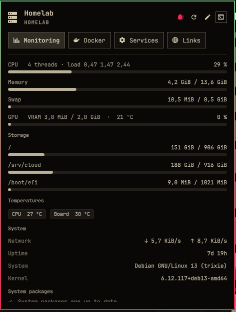

# Homelab for Omarchy

**English** · [Français](README.fr.md)

<p align="center"></p>

A bar widget for the [Omarchy](https://omarchy.org) shell that keeps an eye on
your homelab hosts over plain SSH: nothing to install on the server.

- **Monitoring**: CPU, memory, swap, GPU (NVIDIA / AMD), every mounted disk,
  temperature sensors, network throughput, uptime, OS and kernel. Sections only
  appear when the hardware is there.
- **Docker**: every container with state, CPU and memory; start, stop, restart,
  follow logs in a terminal, and update (pull the image, then recreate the
  container through its Compose project if the image changed; click twice to
  confirm). Search by name or image, sort by name, creation date, CPU or
  memory (ascending or descending) and show all, running or stopped
  containers, or only those with an update. Falls back to passwordless `sudo docker` or
  `podman`.
- **Services**: pick a service from a dropdown to see and drive it:
  - **Home Assistant**: entity count, unavailable entities, toggle lights,
    switches and fans, run scenes and scripts.
  - **Jellyfin**: library counts, who is watching what (with progress and
    transcoding), running tasks, library scan.
  - **Prowlarr**: health warnings, indexer status, test all indexers, search
    every indexer and send a release to your download client.
  - **Navidrome**: songs and scan state, now playing, recently added albums,
    library scan.
- **Alerts and notifications**: a background watcher checks every host even
  while the panel is closed, and sends one desktop notification per new
  problem: host unreachable (and back online), container stopped, crashing or
  unhealthy, disk, memory or temperature over threshold, service not
  responding, Prowlarr health errors and failing indexers, pending reboot.
  The bar icon shows the number of active alerts; the bell in the panel (or
  `a`) opens the alert center. Clicking a notification opens the panel.
- **System packages** (Monitoring tab): pending upgrades with current and new
  version, security fixes first, package-list age, a package operation in
  progress, and a pending reboot (flag file, `needs-restarting`, or a newer
  installed kernel than the running one). "Check" refreshes the lists without
  root where the package manager allows it and skips the image registries,
  so it takes a few seconds. "Upgrade" opens a terminal that runs the
  distribution's upgrade with sudo (or doas), then Flatpak and Snap, whatever
  the remote login shell; the widget re-checks once it finishes.

  | Package manager | Distributions | Lists refreshed without root |
  | --- | --- | --- |
  | apt | Debian, Ubuntu, Mint, Raspberry Pi OS… | yes, private compressed cache in `~/.cache/omarchy-homelab` (~85 MB) |
  | dnf / yum | Fedora, RHEL, Rocky, Alma, CentOS | yes, per-user metadata cache |
  | pacman | Arch, Manjaro, EndeavourOS | yes with `checkupdates` (pacman-contrib), else system lists |
  | zypper | openSUSE, SLES | no, system metadata (security counted from patches) |
  | apk | Alpine | yes, `--no-cache` |
  | xbps | Void | yes, in-memory sync |
  | Flatpak, Snap | any, in addition | yes |
- **Update checks**: every few hours (and on demand) the watcher compares each
  container's image digest with its registry without pulling, counts pending
  system packages (apt, pacman, dnf), and asks the services themselves (Home
  Assistant update entities, Jellyfin, Prowlarr). Update one image or all of
  them from the alert center, or open a terminal that runs the system upgrade.
- **Links**: per-host shortcuts (Homepage, Portainer, Jellyfin…).
- **SSH button**: opens `ssh <host>` in your default terminal.
- Several hosts, switchable from the panel.
- English and French interface.

## Requirements

On the Omarchy machine (all shipped with Omarchy): `ssh`, `curl`, `jq`,
`notify-send`, `xdg-open`, `xdg-terminal-exec`, `md5sum`.

On each homelab host: an SSH server and key-based login, a POSIX `sh` and
the usual coreutils. Optional, per feature:

- Docker tab and image updates: `docker` reachable by the SSH user (docker
  group, passwordless `sudo docker`, or `podman`), `docker compose` and
  `docker buildx` (both shipped with Docker Engine).
- GPU metrics: `nvidia-smi` (NVIDIA) or the amdgpu driver.
- Package updates: one of apt, dnf, yum, pacman (`pacman-contrib` for
  `checkupdates`), zypper, apk, xbps; Flatpak and Snap are picked up too.
- Services: Jellyfin, Home Assistant, Prowlarr or Navidrome with an API key,
  token or account.

Nothing is installed on the hosts. The plugin writes only
`~/.cache/omarchy-homelab/` there (apt list cache, upgrade script).

## Install

```bash
omarchy plugin add https://github.com/dadoux01/omarchy-homelab --enable
```

The widget is added to the right of the bar. Click it, then the pencil, to
create your hosts file.

## Remove

```bash
omarchy plugin remove dadoux01.homelab
```

This removes the plugin and its bar entry. Your own files are left in place;
delete them if you no longer want them:

```bash
rm -f ~/.config/omarchy/homelab.json ~/.config/omarchy/homelab-secrets.json
rm -rf ~/.local/state/omarchy-homelab
ssh <host> rm -rf .cache/omarchy-homelab   # on each homelab host
```

## Configure

Click the pencil in the panel (or press `e`) to create and open
`~/.config/omarchy/homelab.json`:

```json
{
  "hosts": [
    {
      "name": "Homelab",
      "ssh": "user@192.168.1.10",
      "port": 22,
      "links": [
        { "name": "Homepage", "url": "http://192.168.1.10:3000" }
      ]
    }
  ]
}
```

### Services

Services are detected from the host's Docker containers (by image name) and
their URL from the published port; Home Assistant on host networking falls
back to port 8123. Override or add them per host:

```json
"address": "192.168.1.10",
"services": {
  "homeassistant": { "url": "http://192.168.1.10:8123", "entities": ["light.living_room", "scene.movie"] },
  "jellyfin": { "url": "https://jellyfin.example.lan", "insecure": true },
  "prowlarr": false
}
```

`address` replaces the SSH host in detected URLs. `insecure` accepts a
self-signed certificate. `false` hides a service.

Credentials are entered in the panel (key button) and stored in
`~/.config/omarchy/homelab-secrets.json`, mode 600, never in `homelab.json`.
Prowlarr's key can be read over SSH from its `config.xml` in one click. API
calls go through `curl` with the secret passed on a pipe, not on the command
line.

`ssh` takes `user@host`, a bare host, or an alias from `~/.ssh/config`.
Authentication must work without a prompt (SSH key, agent), because the panel
runs ssh with `BatchMode=yes`. The interactive SSH button has no such limit.

### Widget settings

| Setting | Default | |
| --- | --- | --- |
| Language | `English` | `English` or `Français` |
| Hosts file | `~/.config/omarchy/homelab.json` | |
| Secrets file | `~/.config/omarchy/homelab-secrets.json` | |
| Refresh interval | `10` s | only while the panel is open |
| Desktop notifications | on | |
| Notify about updates | on | |
| Background check interval | `120` s | while the panel is closed |
| Update check interval | `6` h | `0` disables automatic checks |
| Disk / memory / temperature thresholds | `90` % / `95` % / `85` °C | |

They live on the widget's entry in `~/.config/omarchy/shell.json`, which
reloads on save:

```json
{ "id": "dadoux01.homelab", "language": "Français" }
```

### Alert and update state

Notified events and the last update check are kept in
`~/.local/state/omarchy-homelab/state.json`, so a restart of the shell does
not announce the same thing twice. A resolved alert is announced again if it
comes back.

Image checks need `docker buildx` on the host (shipped with Docker Engine).
Recreating a container runs `docker compose up -d --no-deps <service>` with
the project, files and directory read from the container's Compose labels.
Stack managers such as Dockge keep root-owned `.env` files that a
docker-group user cannot read, so the update falls back to passwordless
`sudo`, then to running compose inside a container that has the Docker socket
and the stack directory mounted at the same path (Dockge does). A failed pull
(rate limit, offline) still recreates the container when a newer image was
already pulled. Failures show compose's own error under the container.

Docker Hub limits anonymous registry requests per IP; when the limit is hit,
the alert center says so and those images are checked next time. Running
`docker login` on the host raises the limit. A container whose tag already
points at a newer pulled image is reported as "pulled, recreate needed".
A tag pinned to a version (`app:1.2.3`) is reported only if the registry
re-publishes that tag; moving to a newer version means editing the compose
file.

## Keys (panel open)

| Key | Action |
| --- | --- |
| `h` / `l`, `←` / `→`, `1` – `4` | switch tab |
| `[` / `]` | previous / next host |
| `s` or `Enter` | SSH terminal |
| `r` | refresh |
| `e` | edit hosts file |
| `a` | alerts and updates |

In the bar: left click opens the panel, middle click opens SSH, right click
refreshes.

## How it works

Metrics come from a small POSIX script (`remote/metrics.sh`) piped to
`ssh host sh -s`; it only reads `/proc`, `/sys`, `df` and `nvidia-smi`. One
multiplexed connection per host (`ControlPersist=120`) is reused between
refreshes, and polling only happens while the panel is open.

Host targets, ports, container names and URLs are validated before use, all
commands are spawned with argument arrays, and every remote string is shown as
plain text.

## Security

The plugin runs inside Omarchy's unsandboxed shell and executes commands on
your hosts over SSH, so here is exactly what it does:

- Everything remote is a fixed script from `remote/` piped to `sh -s`;
  nothing downloaded is ever executed, and no value from the hosts file,
  the hosts, or the services is interpolated into a shell command (targets,
  ports, container names, URLs and API paths are validated in `bin/homelab`).
- `sudo` is used only in two ways: non-interactive `sudo -n` as a fallback
  for Docker when the SSH user is not in the docker group, and commands run
  in a visible terminal where you type your password (the "Upgrade" button,
  and container logs when docker needs sudo). The plugin never edits sudoers.
- Container start, stop, restart and update, and Home Assistant or Prowlarr
  actions run only when you click them; updates ask for a second click.
- API keys stay in a mode 600 file and reach `curl` through a pipe, never
  the command line. Text coming from hosts and services is displayed as
  plain text.

## IPC

```bash
omarchy-shell dadoux01.homelab toggle
omarchy-shell dadoux01.homelab ssh
omarchy-shell dadoux01.homelab refresh
omarchy-shell dadoux01.homelab tab docker      # monitoring|docker|services|links|alerts
omarchy-shell dadoux01.homelab service jellyfin
omarchy-shell dadoux01.homelab dockerFilter memory desc ""   # sort: name|created|cpu|memory
```

## License

MIT
